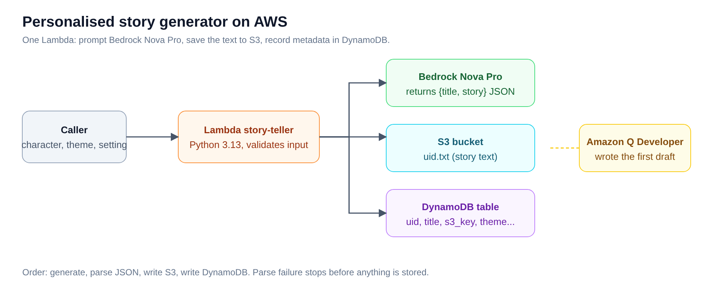
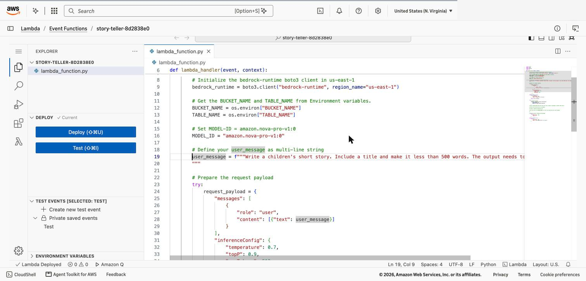
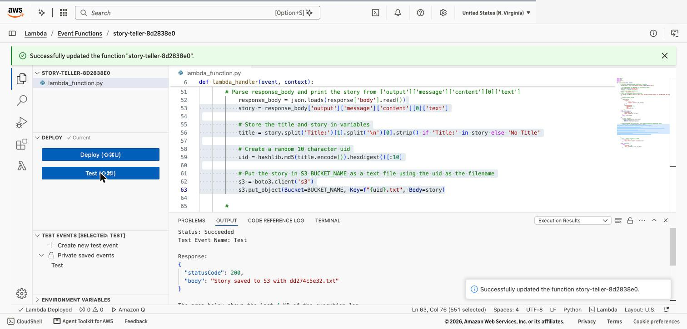
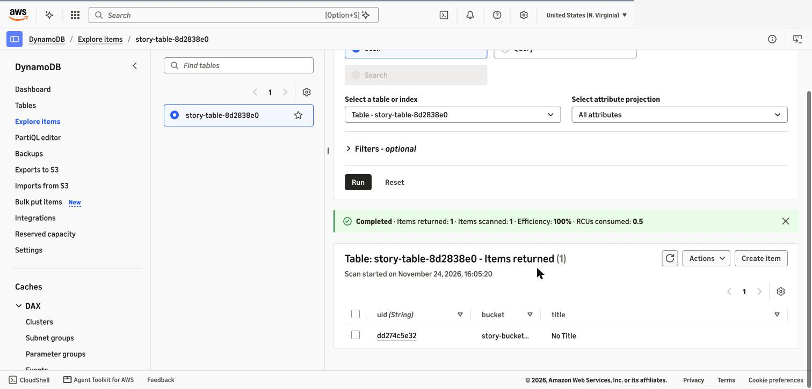

# Personalised children's story generator on AWS

A children's educational publisher wants short stories personalised from a character, a theme and a setting, without writing each one by hand. This repo is a small serverless backend for that: one Lambda asks Amazon Bedrock (Nova Pro) for the story, saves the text to S3 and records metadata in DynamoDB.




## What is real and what is not

| Part | Status |
|---|---|
| Lab Lambda (Amazon Q draft) on real AWS | Ran for real in a temporary lab account: story saved to S3, item written to DynamoDB, validated. Screenshots below. |
| `story_gen/` (this repo's improved code) | Unit-tested against in-memory mocks (24 tests). **Not run against real AWS by the author.** |
| `infra/` CDK stack | Synthesizes and is asserted in tests. **Not deployed.** |
| `scripts/run_on_aws.py` | Written for your own account. Not run. |

## What was fixed versus the lab draft

- Title came from `split('Title:')`, but the model answers in JSON, so the lab stored **"No Title"**. Now parsed from JSON.
- The uid was an MD5 of the title, so **every story collided** on one S3 key and one DynamoDB item. Now `uuid4`.
- `maxTokens` 512 could truncate a 500-word story mid-JSON. Now 1024, and truncation stores nothing.
- Inputs are cleaned and quoted in the prompt; errors no longer leak internals; IAM is least-privilege in CDK.

## Evidence from the lab run

| | |
|---|---|
|  | Amazon Q-generated client, env vars and model id in the Lambda editor |
|  | Test succeeded, story saved to S3 |
|  | DynamoDB item written (note title "No Title", the flaw above) |


Account identifiers are masked in the screenshots.

## Run it locally (no AWS account)

```bash
pip install pytest aws-cdk-lib constructs
python -m pytest -q
python -m local.run_local "Layla the owl" friendship "a desert oasis"
```

The local run uses a mock model that writes a canned story from your inputs, so output is illustrative, not real model output.

## Deploy to your own account

```bash
cd infra && pip install -r requirements.txt && cdk deploy
BUCKET_NAME=<from output> TABLE_NAME=<from output> python scripts/run_on_aws.py "Layla the owl" friendship "an oasis"
```

Enable Bedrock model access for Amazon Nova Pro first. Expect cents at most; see [docs/cost-note.md](docs/cost-note.md). `cdk destroy` removes everything.

## Layout

```
story_gen/     core logic (injected clients) and Lambda handler
local/         mock Bedrock, S3, DynamoDB and a local runner
infra/         CDK stack: S3, DynamoDB, Lambda, scoped IAM
tests/         core, handler and infrastructure tests
docs/          architecture, decision log, cost note, flow, screenshots
```

## Before you would ship this

Add output moderation (for example Bedrock Guardrails), authentication and throttling in front of the Lambda, and a cleanup path for the S3-then-DynamoDB write. Details in the decision log.

## Interview angle

AI coding assistants are fast at boilerplate and weak where the data shape matters. I used Amazon Q for the first draft, tested it, found the title and id logic was wrong, and fixed it with tests. The architecture itself is the standard serverless pattern: Lambda as glue, Bedrock for generation, S3 for objects, DynamoDB for metadata.

MIT licensed.
